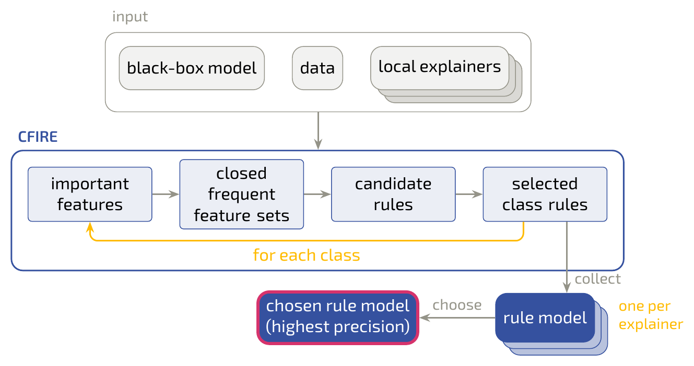

# CFIRE

CFIRE turns local explanations of a black-box classifier on tabular data into a global rule model. For each class it marks the features each explanation deems relevant, mines closed frequent sets of these features, turns them into interval rules with shallow decision trees, and selects a compact set of rules by greedy set cover. The result is a rule model in disjunctive normal form that describes the black box's predictions and rejects where it doesn't apply. Publication: https://doi.org/10.1007/978-3-032-08324-1_1 .

The local explainer is a free choice, by default CFIRE can take any attribution matrix (SHAP, LIME, Integrated Gradients, ...).
`CFIRESelect` fits one rule model per explainer and selects one per black box.



## Install

```bash
pip install git+https://github.com/semueller/CFIRE
```

Requires Python >= 3.10, numpy and scikit-learn.

## Usage

```python
from cfire import CFIRE, CFIRESelect

# X_fit: (n, d) samples, Y_fit: the black box's predicted classes for them,
# E: (n, d) local attributions of the black box for the predicted classes (e.g. from shap, lime or captum)
cf = CFIRE(localexplainer_fn=None, explanations=E, inference_fn=None, random_state=0)
cf.fit(X_fit, Y_fit)

cf.dnf.predict(X_new)    # predicted class per sample, -1 where no rule applies
cf.dnf.to_dict()         # per class: rules as lists of [feature, lower, upper] (None = unbounded)

# several explainers for the same black box: one rule model each, selected by precision on the fit data
sel = CFIRESelect({"shap": E_shap, "lime": E_lime, "ig": E_ig}, random_state=0).fit(X_fit, Y_fit)
sel.selected_, sel.scores_
sel.dnf.predict(X_new)

# pruning (second paper below): remove rules that rarely win on the fit data; the original model is kept
from cfire import prune
pruned = prune(cf.dnf, X_fit, Y_fit, mode="best", tolerance=0.05)   # mode="safe": no change in fit-data predictions
pruned.dnf, pruned.removed, pruned.before, pruned.after
```

Categorical input columns (category codes, binary columns included): pass `feature_types`, one of "numeric" /
"categorical" per column of the black box's input. CFIRE one-hot encodes the categorical columns internally (one
indicator per value seen in the fit data); the rule model keeps the encoding and takes the black box's input.

```python
cf = CFIRE(None, E, None, random_state=0, feature_types=["numeric", "categorical", "numeric"])
cf.fit(X_fit, Y_fit)
cf.dnf.predict(X_new)          # same input columns as X_fit
from cfire import format_rules
format_rules(cf.dnf, feature_names=["age", "colour", "income"])   # e.g. "age >= 0.31 and colour not in {0, 3}"
```

Settings (see the docstring of `CFIRE`): relevance threshold of the binarisation (default 0.01 of the largest
attribution per sample; top-k variants in `cfire.binarise`), frequency threshold of the itemsets (default 0.01),
depth of the rule trees (adaptive by default), `random_state` for the trees.

## Paper versions

The code used for the papers is available at tags:
- `CFIRE: A General Method for Combining Local Explanations` [xAI 2025, Springer Open Access](https://doi.org/10.1007/978-3-032-08324-1_1): tag `wcxai2025`
- `Improving Compactness and Reducing Ambiguity of CFIRE Rule-Based Explanations` [arXiv:2601.03776](https://arxiv.org/abs/2601.03776): tag `pruning-paper` (branch `pruning`)

## Contributors

Tobias Schneider and Ruben Kemna developed the pruning extension and extended the CFIRE class on a fork of this
repository, https://github.com/iMilchshake/CFIRE, where the history of their work is kept. The package in
`src/cfire/` started from their version.

## Licence

MIT, see [LICENSE](LICENSE).
